# ⚡ S.O.S. (SWARM OPERATING SYSTEM) — POWERED BY O.M.E.N. ⚡
> **Neuromorphic Swarm Core & Biomechanical Desktop Actuation Framework v2.0**  
> *Architectural Lineage: O.M.E.N. (Genesis) ➔ Fortress v1.26 ➔ Jeebes & DocuAI ➔ S.O.S. (Powered by O.M.E.N.)*  
> *Substrate: GMKtec / AMD Ryzen AI Max+ 395 (Strix Halo) | Clean Systems Architecture*

```text
       ╔═════════════════════════════════════════════════╗
       ║                                                 ║
       ║    █▀ █▀ █▀     █▀ █▀█ █▀ █▀█ █▀▄ █▀█             ║
       ║    ▄█ ▄█ ▄█     ▄█ █▄█ ▄█ █▄█ █▄▀ █▄█             ║
       ║                                                 ║
       ║       [ S.O.S. — POWERED BY O.M.E.N. ]          ║
       ║       [ NEUROMORPHIC SWARM CORE v2.0 ]          ║
       ╚═════════════════════════════════════════════════╝
```

---

<p align="center">
  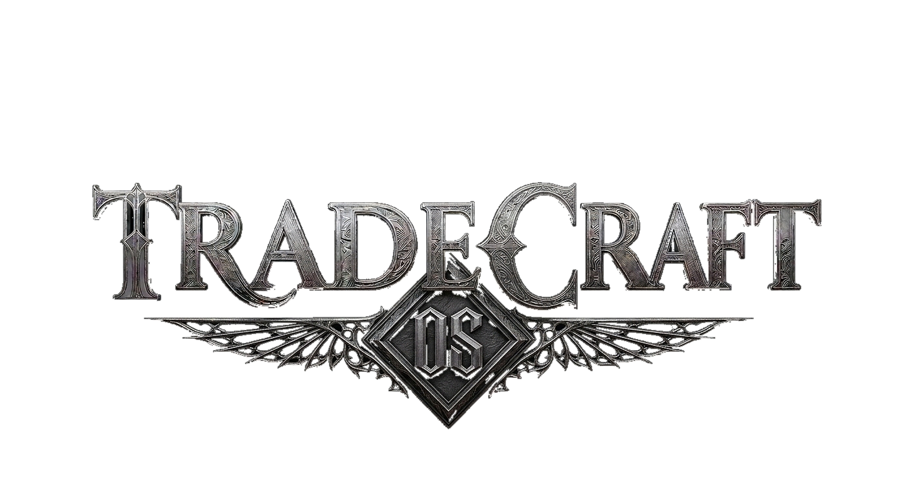
</p>

<h1 align="center">TRADECRAFT AI PLATFORM</h1>
<h3 align="center">The Sovereign AI Operating System for Vocational Education & Industrial Trades</h3>

<p align="center">
  <strong>Built by Michael Gorby Jr.</strong> • Powered by O.M.E.N. • Battle-tested in live trade school classrooms
</p>

<p align="center">
  
  
  
</p>

---

<p align="center">
  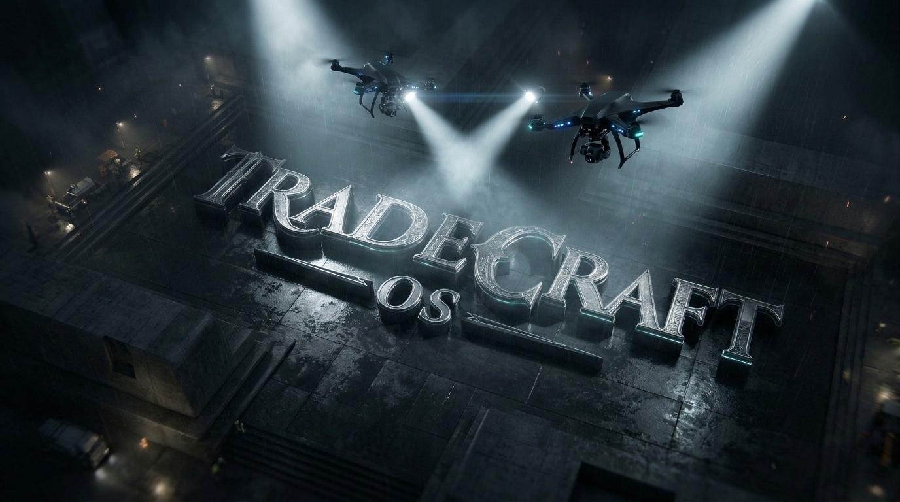
</p>

---

## 💥 The Raw Truth: Why TradeCraft Exists

Trade school education in America is fundamentally broken in the exact place that matters most: **the instructor's desk**.

Master electricians, HVAC mechanics, plumbers, and welders leave lucrative $100K+ field careers to teach the next generation. When they step into the classroom, they are slammed with 15 to 20 hours a week of pure administrative friction:
- Hand-grading stacks of paper bubble sheets and lab reports.
- Manually compiling NCCER curriculum, lesson plans, and guided notes from dense 800-page textbooks.
- Fighting low-engagement classrooms where students stare at blank worksheets.

**I built TradeCraft to kill that friction entirely.** 

TradeCraft is not a startup pitch deck fantasy or a toy wrapper around an OpenAI API. It is an end-to-end, sovereign edge platform running **live on production hardware** at Ohio Business College right now. It takes raw scans straight from the campus Konica Bizhub copier, grades exams optically in under 3 seconds, injects results straight into student vaults, and runs local, private AI tutoring powered by our neuromorphic multi-agent swarm.

---

## 📊 Executive & Investor Pitch Deck Suite

We have documented the entire business model, operational moat, hardware topology, and educational transformation across two executive-ready decks. The complete PDFs and speaker scripts are directly accessible right here in this repository:

<p align="center">
  <a href="decks/TradeCraft_OS_Board_Deck.pdf">
    
  </a>
  &nbsp;&nbsp;&nbsp;
  <a href="decks/TradeCraft_OS_Vision_Deck.pdf">
    
  </a>
</p>

| Deck | Core Focus | Direct Link | Full Speaker Script |
|---|---|---|---|
| **Board Briefing Deck (21 Slides)** | Hard financials, unit economics, instructor time-savings metrics, FERPA compliance, and institutional scale. | [📄 TradeCraft_OS_Board_Deck.pdf](decks/TradeCraft_OS_Board_Deck.pdf) | [🗣️ Speaker Notes](decks/Board_Deck_Speaker_Notes.md) |
| **Vision & Origin Story Deck** | The founding philosophy, classroom battle testing, student psychological engagement loops, and product roadmap. | [📄 TradeCraft_OS_Vision_Deck.pdf](decks/TradeCraft_OS_Vision_Deck.pdf) | [🗣️ Speaker Notes](decks/Vision_Deck_Speaker_Notes.md) |

---

## 📸 Production Gallery: What The Platform Actually Looks Like

Every single screen shown below is a live, functional module in our production stack — not a Figma mockup.

### 1. Instructor Command Center & Live Launchpad
> *The unified glass cockpit where faculty access all testing grounds, curriculum vaults, and live session stats.*

<p align="center">
  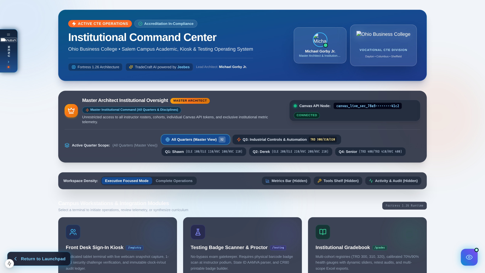
</p>

---

### 2. DocuAI — Document Intelligence & Textbook Synthesizer
> *Drop an 800-page NCCER manual or codebook scan into DocuAI. It extracts diagrams, generates structured student workups, builds interactive quizzes, and vectorizes content into ChromaDB RAG in seconds.*

<p align="center">
  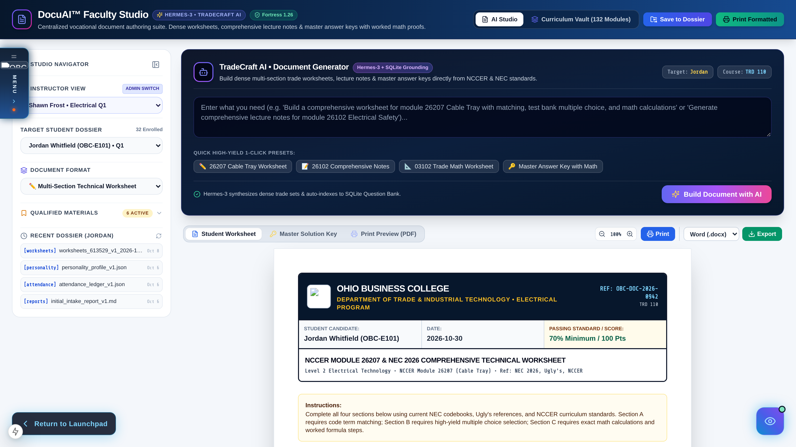
</p>

---

### 3. Automated OMR Optical Grading & Deep Analytics
> *Optical mark recognition pipeline. Students bubble physical exam sheets; copiers spit PDF scans over LAN; our watchdogs parse bubbles, flag anomalies, and update gradebooks automatically.*

<p align="center">
  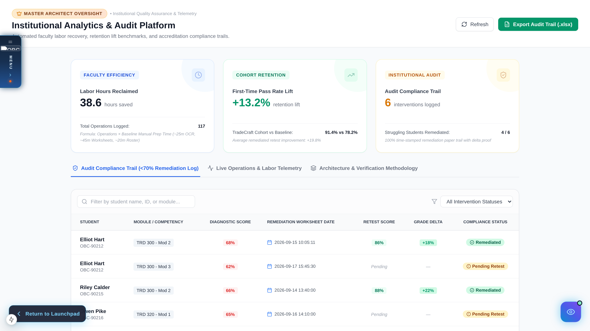
  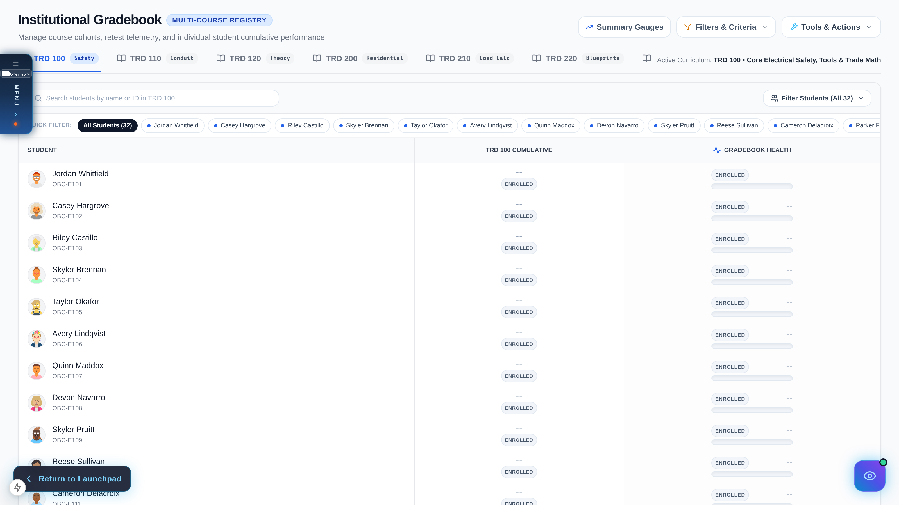
</p>

---

### 4. Interactive Shop Labs & Hardware Schematics
> *Interactive schematic generators for Electrical and HVAC wiring, refrigerant flow, and conduit bending calculations. Turns static lab manuals into step-by-step interactive exercises.*

<p align="center">
  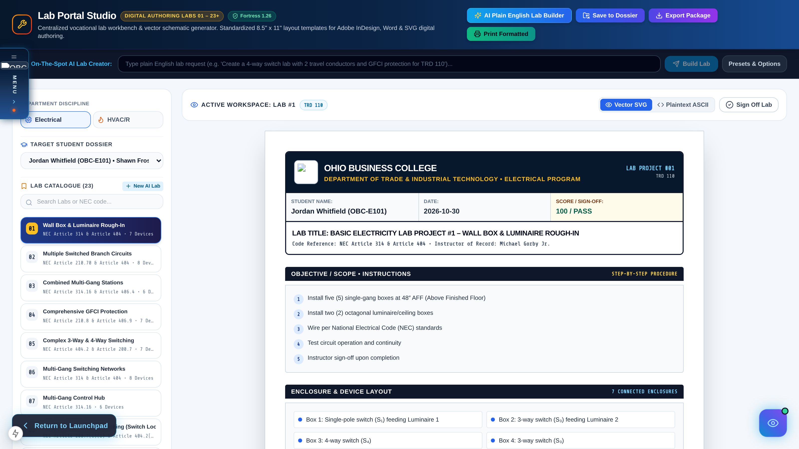
</p>

---

### 5. TradeCrash Arena — Multiplayer Gamified Knowledge Verification
> *Real-time classroom clash arena. Students battle head-to-head on NEC electrical code, refrigerant charts, and safety compliance with arcade telemetry and live leaderboards.*

<p align="center">
  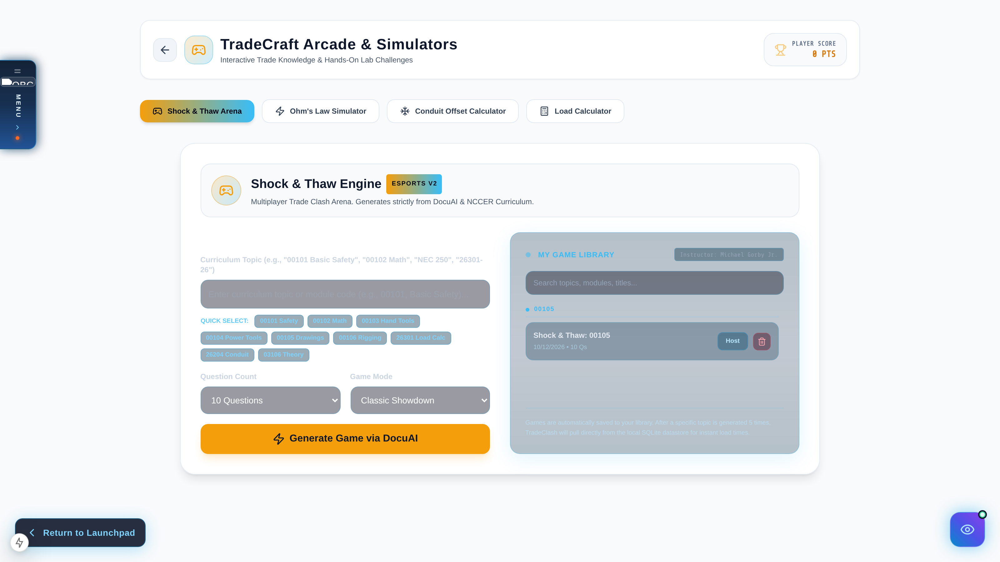
</p>

---

### 6. AI Chat & Sovereign Knowledge Hub
> *Zero cloud leaks. Local Hermes-3-8B and Qwen models running over private Tailscale mesh directly answer student technical questions with verified citations from official trade texts.*

<p align="center">
  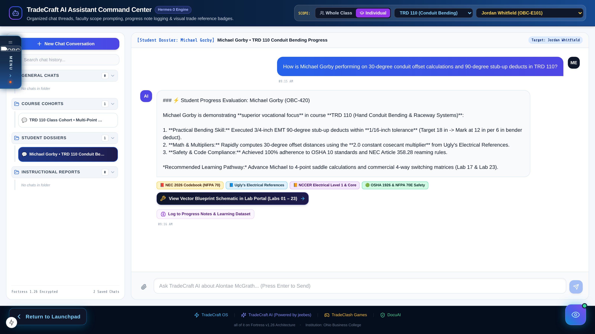
</p>

---

## 🏛️ System Architecture: The Multi-Engine Fleet

TradeCraft is engineered as a coordinated multi-engine stack where every component has a distinct operational role:

<p align="center">
  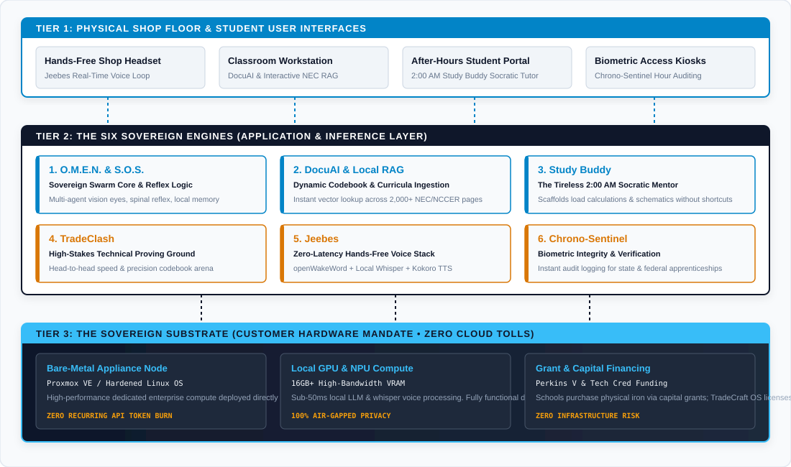
</p>

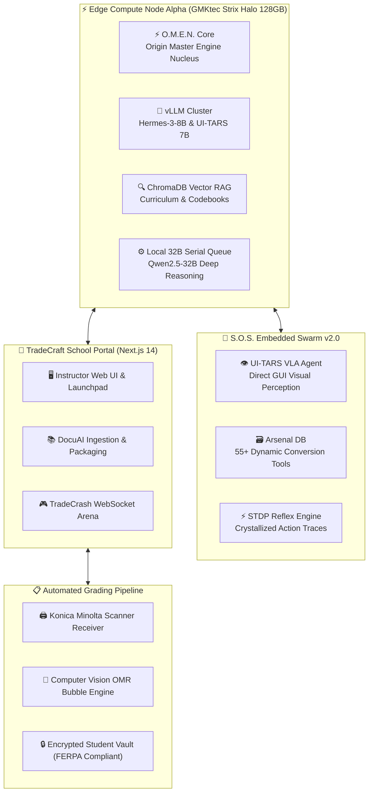

---

## 🛡️ The Operational Moat & Pipeline

We didn't just build software; we built an institutional moat:

<p align="center">
  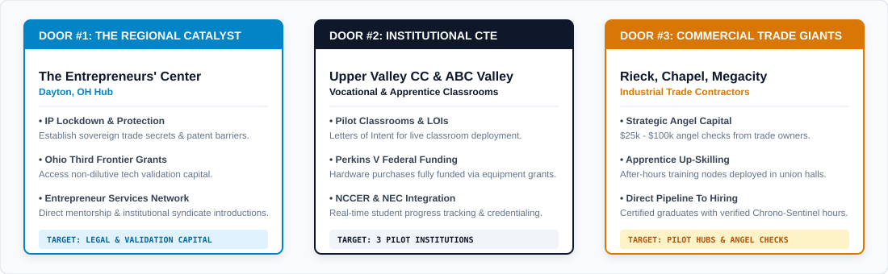
</p>

<p align="center">
  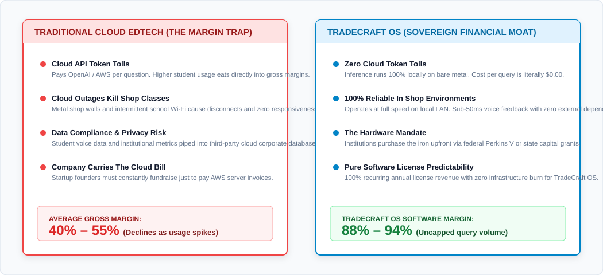
</p>

1. **Air-Gapped & Sovereign:** Zero dependency on fragile external APIs. If the internet goes down on campus, TradeCraft keeps grading, instructing, and running locally.
2. **Proprietary NCCER Data Lake:** Comprehensive question banks, exam matrices, and lab sheets compiled from 15+ modules across Electrical, HVAC, Core, and Photovoltaics.
3. **Biomechanical Actuation:** S.O.S. Swarm handles desktop chores, formatting, and administrative clicks using natural Hermite spline mouse actuation and closed-loop visual perceptual hashing.

---

## 🔒 Platform Repositories & Fleet Access

The TradeCraft AI Platform source code is organized into dedicated repositories under the [`@addictmichael89`](https://github.com/addictmichael89) namespace:

| Repository | Visibility | Purpose |
|---|---|---|
| [`sos-platform`](https://github.com/addictmichael89/sos-platform) | 🔒 Private | Core S.O.S. Swarm OS, UI-TARS 7B VLA actuator, 32B queue, 55+ Arsenal tools, Astra cluster node. |
| [`tradecraft-school-portal`](https://github.com/addictmichael89/tradecraft-school-portal) | 🔒 Private | Production Next.js 14 platform, DocuAI, automated grading endpoints, ChromaDB vector search. |
| [`tradecraft-curriculum-tools`](https://github.com/addictmichael89/tradecraft-curriculum-tools) | 🔒 Private | 86+ curriculum builders, OMR grading daemons, Fortress v1.26 system automation tools. |
| [`tradecraft-showcase`](https://github.com/addictmichael89/tradecraft-showcase) | 🌐 **Public** | Public flagship showcase, executive whitepapers, investor pitch decks, UI screenshots. |
| [`sos-avatar-forge`](https://github.com/addictmichael89/sos-avatar-forge) | 🔒 Private | 3D web-native avatar creation studio (React Three Fiber + FastAPI + Arena presence hub). |
| [`jeebes-oracle-studio`](https://github.com/addictmichael89/jeebes-oracle-studio) | 🔒 Private | 27B abliterated AI oracle engine, antiquity lore databases, and episodic studio pipeline. |

---

## 📬 Contact & Inquiries

**Michael Gorby Jr.**  
*Architect & Lead Systems Developer*  
GitHub: [@addictmichael89](https://github.com/addictmichael89)

---

<p align="center">
  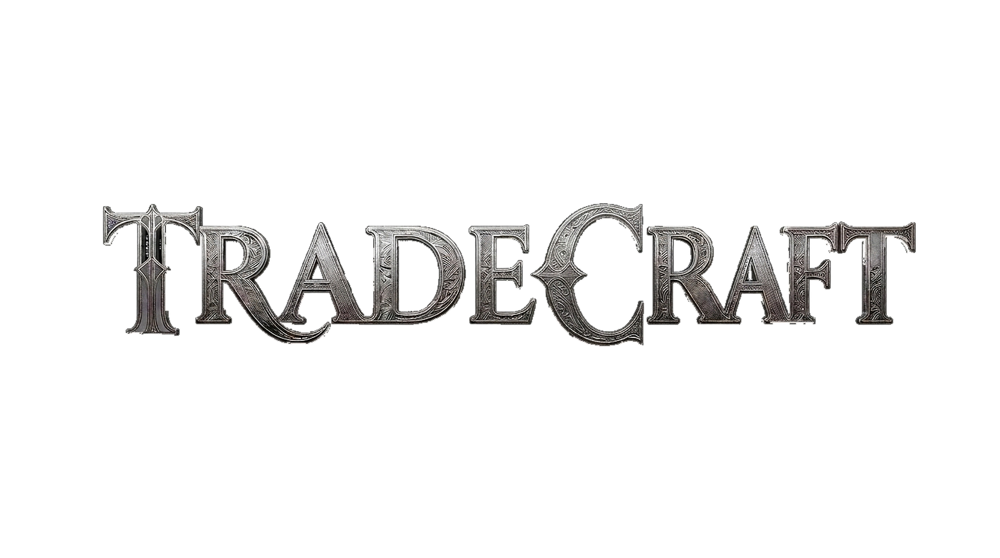
</p>

<p align="center">
  <em>⚡ S.O.S. Powered by O.M.E.N. • Clean Systems Architecture • Designed & Built for the Trades</em>
</p>
